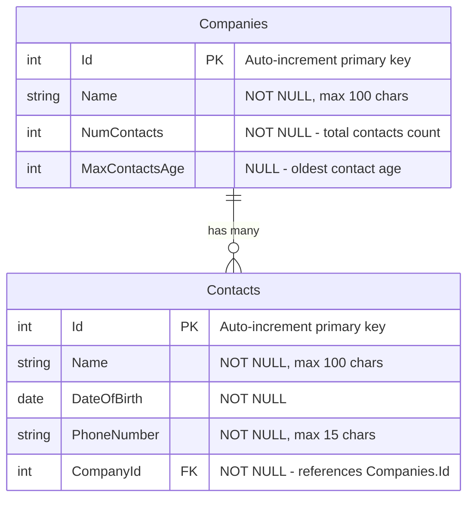

# Companies Address Book

An ASP.NET Core 9 MVC web application for managing a company address book with contacts. Supports importing companies from CSV files, listing contacts per company, and adding/editing contacts.

---

## Table of Contents

1. [Tech Stack](#tech-stack)
2. [Database Schema](#database-schema)
3. [Prerequisites](#prerequisites)
4. [Deployment on IIS with SQL Server](#deployment-on-iis-with-sql-server)

---

## Tech Stack

| Layer        | Technology                              |
|--------------|-----------------------------------------|
| Framework    | ASP.NET Core 9 MVC (.NET 9)             |
| ORM          | Entity Framework Core 9                 |
| Database     | SQL Server (any edition)                |
| View Engine  | Razor Views                             |
| Hosting      | IIS (Internet Information Services)     |

---

## Database Schema

The application uses a single SQL Server database named **`CompaniesAddressBookDB`** with two tables.



### Table Details

#### `Companies`
| Column          | Type            | Nullable | Notes                              |
|-----------------|-----------------|----------|------------------------------------|
| `Id`            | `int`           | No       | Primary Key, auto-incremented      |
| `Name`          | `nvarchar(100)` | No       | Company display name               |
| `NumContacts`   | `int`           | No       | Denormalized count of contacts     |
| `MaxContactsAge`| `int`           | Yes      | Age of the oldest contact, or NULL |

#### `Contacts`
| Column        | Type            | Nullable | Notes                              |
|---------------|-----------------|----------|------------------------------------|
| `Id`          | `int`           | No       | Primary Key, auto-incremented      |
| `Name`        | `nvarchar(100)` | No       | Full name of the contact           |
| `DateOfBirth` | `date`          | No       | Used to compute age                |
| `PhoneNumber` | `nvarchar(15)`  | No       | Contact phone number               |
| `CompanyId`   | `int`           | No       | Foreign Key → `Companies.Id`       |

> **Note:** `NumContacts` and `MaxContactsAge` on the `Companies` table are denormalized computed values kept in sync by the application layer whenever contacts are added or removed.

---

## Prerequisites

Before deploying, make sure the target machine has the following installed:

- **Windows Server** (or Windows 10/11) with **IIS** enabled
- **SQL Server** (any edition — Express, Standard, or Developer)
- **[.NET 9 Hosting Bundle](https://dotnet.microsoft.com/en-us/download/dotnet/9.0)** — includes the ASP.NET Core Runtime and the IIS integration module (ASP.NET Core Module v2)

---

## Deployment on IIS with SQL Server

### Step 1 — Install the .NET 9 Hosting Bundle

1. Download the **.NET 9 Hosting Bundle** from:
   `https://dotnet.microsoft.com/en-us/download/dotnet/9.0`
2. Run the installer and complete the setup.
3. After installation, **restart IIS** by opening a Command Prompt as Administrator and running:
   ```
   iisreset
   ```

---

### Step 2 — Configure the Connection String

On the **production machine**, open the published `appsettings.json` file located in:
```
C:\inetpub\wwwroot\CompaniesAddressBook\appsettings.json
```

Update the `DefaultConnection` to point to your SQL Server instance:

```json
{
  "ConnectionStrings": {
    "DefaultConnection": "Server=YOUR_SERVER_NAME; Database=CompaniesAddressBookDB; Integrated Security=True; Encrypt=False;"
  }
}
```

Replace `YOUR_SERVER_NAME` with your actual SQL Server instance name (e.g., `.` for the local default instance, or `.\SQLEXPRESS` for SQL Server Express).

> **Integrated Security=True** means the IIS Application Pool identity will be used to connect to SQL Server. See Step 6 for granting the correct permissions.

---

### Step 3 — Apply Database Migrations

The database schema is managed by **EF Core Migrations**. Apply them using one of the two options below:

**Option A — Using the EF Core CLI (requires .NET SDK on the production machine)**

1. Open a Command Prompt as Administrator on the production machine.
2. Navigate to the published folder:
   ```
   cd C:\inetpub\wwwroot\CompaniesAddressBook
   ```
3. Run the migrations:
   ```
   dotnet ef database update --connection "Server=YOUR_SERVER_NAME; Database=CompaniesAddressBookDB; Integrated Security=True; Encrypt=False;"
   ```

**Option B — Using a SQL Migration Script (no SDK required on production)**

1. On your **development machine**, generate an idempotent SQL script from the migrations:
   ```
   dotnet ef migrations script --output migrations.sql --idempotent
   ```
2. Copy `migrations.sql` to the production machine.
3. Open SSMS, connect to your SQL Server instance, and execute the script against `CompaniesAddressBookDB`.
