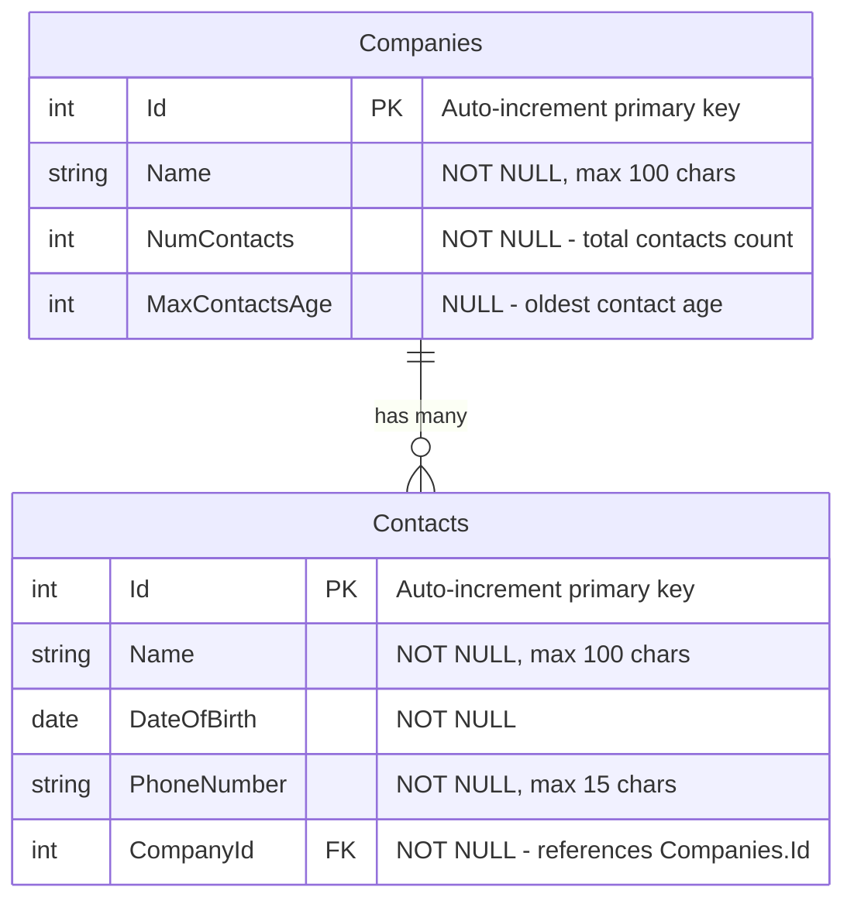

# Companies Address Book

An ASP.NET Core 9 MVC web application for managing a company address book with contacts. Supports importing companies from CSV files, listing contacts per company, and adding/editing contacts.

---

## Table of Contents

1. [Tech Stack](#tech-stack)
2. [Database Schema](#database-schema)
3. [Prerequisites](#prerequisites)
4. [Deployment on IIS with SQL Server](#deployment-on-iis-with-sql-server)

---

## Tech Stack

| Layer        | Technology                              |
|--------------|-----------------------------------------|
| Framework    | ASP.NET Core 9 MVC (.NET 9)             |
| ORM          | Entity Framework Core 9                 |
| Database     | SQL Server (any edition)                |
| View Engine  | Razor Views                             |
| Hosting      | IIS (Internet Information Services)     |

---

## Database Schema

The application uses a single SQL Server database named **`CompaniesAddressBookDB`** with two tables.



### Table Details

#### `Companies`
| Column          | Type            | Nullable | Notes                              |
|-----------------|-----------------|----------|------------------------------------|
| `Id`            | `int`           | No       | Primary Key, auto-incremented      |
| `Name`          | `nvarchar(100)` | No       | Company display name               |
| `NumContacts`   | `int`           | No       | Denormalized count of contacts     |
| `MaxContactsAge`| `int`           | Yes      | Age of the oldest contact, or NULL |

#### `Contacts`
| Column        | Type            | Nullable | Notes                              |
|---------------|-----------------|----------|------------------------------------|
| `Id`          | `int`           | No       | Primary Key, auto-incremented      |
| `Name`        | `nvarchar(100)` | No       | Full name of the contact           |
| `DateOfBirth` | `date`          | No       | Used to compute age                |
| `PhoneNumber` | `nvarchar(15)`  | No       | Contact phone number               |
| `CompanyId`   | `int`           | No       | Foreign Key → `Companies.Id`       |

> **Note:** `NumContacts` and `MaxContactsAge` on the `Companies` table are denormalized computed values kept in sync by the application layer whenever contacts are added or removed.

---

## Prerequisites

Before deploying, make sure the target machine has the following installed:

- **Windows Server** (or Windows 10/11) with **IIS** enabled
- **SQL Server** (any edition — Express, Standard, or Developer)
- **[.NET 9 Hosting Bundle](https://dotnet.microsoft.com/en-us/download/dotnet/9.0)** — includes the ASP.NET Core Runtime and the IIS integration module (ASP.NET Core Module v2)

---

## Deployment on IIS with SQL Server

### Step 1 — Install the .NET 9 Hosting Bundle

1. Download the **.NET 9 Hosting Bundle** from:
   `https://dotnet.microsoft.com/en-us/download/dotnet/9.0`
2. Run the installer and complete the setup.
3. After installation, **restart IIS** by opening a Command Prompt as Administrator and running:
   ```
   iisreset
   ```

---

### Step 2 — Create the SQL Server Database

1. Open **SQL Server Management Studio (SSMS)** and connect to your SQL Server instance.
2. Open a **New Query** window and run the following to create the database:
   ```sql
   CREATE DATABASE CompaniesAddressBookDB;
   ```
3. The tables will be created automatically by EF Core migrations in Step 5. You do not need to create them manually.

---

### Step 3 — Publish the Application

On your **development machine** (where you have Visual Studio / .NET SDK):

1. Open a terminal and navigate to the project folder (where the `.csproj` file is):
   ```
   cd "d:\.Net Projects\Companies_Address_Book\Companies_Address_Book"
   ```
2. Run the publish command:
   ```
   dotnet publish -c Release -o C:\publish\CompaniesAddressBook
   ```
3. Copy the entire contents of `C:\publish\CompaniesAddressBook` to the target/production machine into:
   ```
   C:\inetpub\wwwroot\CompaniesAddressBook
   ```

---

### Step 4 — Configure the Connection String

On the **production machine**, open the published `appsettings.json` file located in:
```
C:\inetpub\wwwroot\CompaniesAddressBook\appsettings.json
```

Update the `DefaultConnection` to point to your SQL Server instance:

```json
{
  "ConnectionStrings": {
    "DefaultConnection": "Server=YOUR_SERVER_NAME; Database=CompaniesAddressBookDB; Integrated Security=True; Encrypt=False;"
  }
}
```

Replace `YOUR_SERVER_NAME` with your actual SQL Server instance name (e.g., `.` for the local default instance, or `.\SQLEXPRESS` for SQL Server Express).

> **Integrated Security=True** means the IIS Application Pool identity will be used to connect to SQL Server. See Step 6 for granting the correct permissions.

---

### Step 5 — Apply Database Migrations

The database schema is managed by **EF Core Migrations**. Apply them using one of the two options below:

**Option A — Using the EF Core CLI (requires .NET SDK on the production machine)**

1. Open a Command Prompt as Administrator on the production machine.
2. Navigate to the published folder:
   ```
   cd C:\inetpub\wwwroot\CompaniesAddressBook
   ```
3. Run the migrations:
   ```
   dotnet ef database update --connection "Server=YOUR_SERVER_NAME; Database=CompaniesAddressBookDB; Integrated Security=True; Encrypt=False;"
   ```

**Option B — Using a SQL Migration Script (no SDK required on production)**

1. On your **development machine**, generate an idempotent SQL script from the migrations:
   ```
   dotnet ef migrations script --output migrations.sql --idempotent
   ```
2. Copy `migrations.sql` to the production machine.
3. Open SSMS, connect to your SQL Server instance, and execute the script against `CompaniesAddressBookDB`.

---

### Step 6 — Grant SQL Server Permissions to the IIS App Pool

Because the connection string uses **Integrated Security**, the IIS Application Pool's Windows identity must have access to the database.

1. In **SSMS**, open a **New Query** and run the following (replace `CompaniesAddressBook` with your actual App Pool name if you chose a different one):
   ```sql
   USE CompaniesAddressBookDB;

   -- Create a login for the IIS App Pool identity
   CREATE LOGIN [IIS APPPOOL\CompaniesAddressBook] FROM WINDOWS;

   -- Map it to a database user and grant data access
   CREATE USER [IIS APPPOOL\CompaniesAddressBook]
       FOR LOGIN [IIS APPPOOL\CompaniesAddressBook];

   ALTER ROLE db_datareader ADD MEMBER [IIS APPPOOL\CompaniesAddressBook];
   ALTER ROLE db_datawriter ADD MEMBER [IIS APPPOOL\CompaniesAddressBook];
   ```

> **Alternative:** If you prefer SQL Server Authentication, update the connection string to use `User Id=youruser; Password=yourpassword;` and remove `Integrated Security=True`. In that case, this step is not needed.

---

### Step 7 — Create the IIS Website

1. Open **IIS Manager** (press `Win + R`, type `inetmgr`, press Enter).
2. In the left panel, expand the server node, right-click **Sites** → **Add Website…**
3. Fill in the dialog:

   | Field                | Value                                         |
   |----------------------|-----------------------------------------------|
   | **Site name**        | `CompaniesAddressBook`                        |
   | **Application pool** | Leave as auto-created or select existing      |
   | **Physical path**    | `C:\inetpub\wwwroot\CompaniesAddressBook`     |
   | **Binding type**     | `http` (or `https` if you have a certificate) |
   | **Port**             | `80` (or another available port)              |

4. Click **OK**.

---

### Step 8 — Configure the Application Pool

1. In IIS Manager, click **Application Pools** in the left panel.
2. Find the pool used by your site (e.g., `CompaniesAddressBook`).
3. Right-click it → **Basic Settings…**
4. Set **.NET CLR Version** to **`No Managed Code`** (ASP.NET Core runs out-of-process via Kestrel).
5. Click **OK**.
6. Right-click the pool → **Advanced Settings…**
7. Confirm **Enable 32-Bit Applications** is set to **`False`**.
8. Click **OK**.

---

### Step 9 — Set Folder Permissions

The IIS Application Pool identity needs read access to the published folder.

1. In Windows Explorer, right-click `C:\inetpub\wwwroot\CompaniesAddressBook` → **Properties**.
2. Go to the **Security** tab → **Edit…** → **Add…**
3. In the object name box, type exactly:
   ```
   IIS AppPool\CompaniesAddressBook
   ```
4. Click **Check Names** to resolve the identity → **OK**.
5. Grant **Read & Execute** permissions → **Apply** → **OK**.

---

### Step 10 — Start the Site and Verify

1. In IIS Manager, select your site under **Sites**.
2. In the right-hand **Actions** panel, click **Start**.
3. Open a browser on the server and navigate to:
   ```
   http://localhost/
   ```
   (Use the port you configured if it is not 80.)
4. You should see the **Companies Address Book** home page listing companies.

---

### Troubleshooting

| Symptom | Likely Cause | Fix |
|---|---|---|
| `HTTP 500.19` on startup | Bad `web.config` or wrong physical path | Verify the site's physical path in IIS matches the publish output folder |
| `HTTP 500.30` — ANCM in-process handler load failure | .NET 9 Hosting Bundle not installed or IIS not restarted | Install the Hosting Bundle and run `iisreset` |
| `Login failed for user 'IIS APPPOOL\...'` | Missing SQL Server login for the App Pool identity | Follow Step 6 to grant database access |
| `Cannot open database "CompaniesAddressBookDB"` | Database not created or migrations not applied | Complete Steps 2 and 5 |
| Blank page or 404 on sub-pages | App Pool not set to No Managed Code | Set the .NET CLR Version to **No Managed Code** (Step 8) |